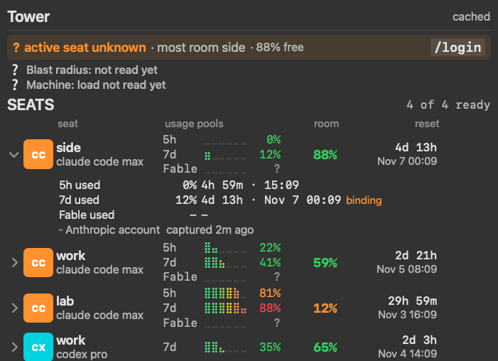

# Tower

A macOS menu bar app for people who run several AI coding subscriptions. It shows
where every account stands (usage per window, room left, when it resets) and tells
you which one to switch to before you get stuck.



*The screenshot uses invented accounts (`scripts/demo-store.py`).*

## Quick start

macOS 14 or later, Apple silicon:

```bash
gh release download --repo yonatangross/tower --pattern 'Tower.app.zip*'
shasum -a 256 -c Tower.app.zip.sha256 && ditto -x -k Tower.app.zip ~/Applications
mkdir -p ~/.local/bin && ln -sf ~/Applications/Tower.app/Contents/MacOS/Tower ~/.local/bin/tower
open ~/Applications/Tower.app
```

Then sign into each Claude Code account once with `/login`. For Cursor, click
**Connect Cursor** on its row once; Tower keeps its own Cursor sign-in and never
touches the Cursor app's. Blocked on first
launch? See [troubleshooting](docs/playbooks/troubleshooting.md#macos-blocks-the-first-launch).

## Install with your agent

Paste this into Claude Code, Codex or Cursor. The agent runs the steps in
[AGENTS.md](AGENTS.md#install-tower-for-the-user) without asking you anything, and
stops if a check fails:

```text
Install Tower from github.com/yonatangross/tower: follow AGENTS.md, section
"Install Tower for the user". Verify the checksum, link ~/.local/bin/tower,
register the MCP server for this agent, run `tower mcp --self-test`, and tell me
what you did. Do not open System Settings for me; tell me if macOS blocks the
first launch.
```

The agent downloads the release with `gh`, checks its SHA-256, installs to
`~/Applications`, links `~/.local/bin/tower`, registers the MCP server and runs
its self-test. If macOS blocks the first launch, it stops and asks you to press
**Open Anyway** ([First launch](#first-launch-open-anyway)); it never changes
Gatekeeper itself.

Register the MCP server by hand, if you prefer:

| Agent | How |
| --- | --- |
| Claude Code | `claude mcp add --scope user tower -- ~/.local/bin/tower mcp` |
| Codex | `~/.codex/config.toml`: `[mcp_servers.tower]`, `command = "/Users/<you>/.local/bin/tower"`, `args = ["mcp"]` |
| Cursor | `~/.cursor/mcp.json`: `{"mcpServers": {"tower": {"command": "/Users/<you>/.local/bin/tower", "args": ["mcp"]}}}` |

Then `tower mcp --self-test` (a non zero exit means the server is broken).

## Playbooks

| Playbook | For |
| --- | --- |
| [Setup](docs/playbooks/setup.md) | install, first run, Keychain trust, adding accounts |
| [Multi-account](docs/playbooks/multi-account.md) | several Claude Code seats, Codex, Cursor, switching fast |
| [MCP](docs/playbooks/mcp.md) | let Claude Code, Codex or Cursor ask which account has room |
| [Troubleshooting](docs/playbooks/troubleshooting.md) | Gatekeeper, Intel Macs, build errors, odd rows |
| [Uninstall](docs/playbooks/uninstall.md) | remove the app and everything it stored |

## What it does

- **Seats.** Real Claude Code usage for each account you have signed into: the
  5 hour and weekly windows, the room left, and the next reset. Codex and Cursor
  plans sit beside them.
- **Advice.** Which seat has the most room, and when to switch.
- **MCP server.** `tower mcp` answers the same questions over the Model Context
  Protocol, so any agent (Claude Code, Codex, Cursor and others) can ask which
  account has room. See [docs/mcp-surface.md](docs/mcp-surface.md).
- **Extras.** OpenRouter balance, agent lanes (Muse, Devin, the Cursor CLI,
  Antigravity, and Pi with its spend this month and today as a share of the
  OpenRouter budget) and live Claude Code sessions, when those tools are present.
- **CLI.** `tower status`, `tower rotate`, `tower retrust`, `tower panelshot`, `tower selftest`.

It reads the same numbers Claude Code's `/usage` screen shows, through an
**undocumented** endpoint that can change with any Claude Code release.

## Before you use it

- Tower reads the Claude Code credential from your login Keychain. With
  **Remember Claude seats** on (the default) it keeps each signed-in seat's
  access token in its own Keychain item, so it can read that seat's usage after
  you switch away, until the token expires. It never stores a refresh token and
  never renews a token; a seat whose token expired reads "needs login" until you
  sign into it again. Turn the option off, or press **Forget**, to delete those
  items.
- Check that using several subscriptions this way fits your provider's terms.
  Tower does not decide that for you.
- Nothing leaves your Mac except requests to the providers' own APIs.

## Install

Requirements: macOS 14 or later on Apple silicon. The release zip is an arm64
build; on an Intel Mac, build from source.

From a release (no build tools needed):

```bash
gh release download --repo yonatangross/tower --pattern 'Tower.app.zip*'
shasum -a 256 -c Tower.app.zip.sha256
ditto -x -k Tower.app.zip ~/Applications
```

### First launch: "Open Anyway"

Tower is not notarized by Apple (release builds are ad hoc signed), so when the
zip came through a browser, macOS blocks the first launch with "Apple could not
verify Tower is free of malware". This happens once per install. Check the
checksum first (the `shasum` line above prints `OK`), then:

1. Open Tower once (double-click `~/Applications/Tower.app`) and press **Done**
   on the warning.
2. Open **System Settings**, then **Privacy & Security**.
3. Scroll down to Security. Next to "Tower was blocked to protect your Mac",
   press **Open Anyway**.
4. Press **Open Anyway** again in the dialog and enter your login password if
   macOS asks.

Tower then starts normally and macOS does not ask again for this copy. The
Terminal alternative is in
[troubleshooting](docs/playbooks/troubleshooting.md#macos-blocks-the-first-launch).
To remove Tower, follow [uninstall](docs/playbooks/uninstall.md).

### Upgrading from a build before v0.1

Builds before v0.1 installed as `ai.yonatan-hq.claude-limits` with the executable
`HQClaudeLimits`; v0.1 is `ai.yonyon.tower` with the executable `Tower`. On its
first launch Tower moves `~/Library/Application Support/HQClaudeLimits/` into
`~/Library/Application Support/Tower/` and copies your settings to the new id,
never overwriting anything the new install already has. `scripts/install.sh`
also stops the old process, moves start-at-login to the new id when it was on,
and repoints a `~/.local/bin/tower` link that named the old executable.

What macOS ties to the old id and asks for once more:

- **Keychain.** Until you press **Re-trust** (beside **Forget** in the panel),
  Tower reads only the seat you are signed into, through the Claude Code
  credential; the other remembered seats stay unread. Nothing else ever shows the
  Keychain dialog: launches, background refreshes, `tower status` and `tower mcp`
  never do, and Tower never asks for your login password.

  | Situation | Keychain prompts |
  | --- | --- |
  | Fresh install | 0 |
  | First Re-trust after upgrading from a build before v0.1 | one **Always Allow** per remembered seat, once (macOS gives each old item its own access list) |
  | Any later identity change (a new release, which is ad hoc signed) | 1, when you press Re-trust |
  | Background refresh, CLI, MCP | 0, always |
- **Privacy prompts.** Any permission macOS granted the old build (for example
  access to another app's data) is asked for again the first time Tower needs it.
- **Start at login**, if you installed by unzipping rather than with
  `scripts/install.sh`: run `tower login-item on` once.

## Build from source

Requirements: Xcode 16 or later, or the Command Line Tools with a macOS SDK
whose SwiftUI macro plugin loads (see the note below).

```bash
git clone https://github.com/yonatangross/tower.git
cd tower
scripts/build-app.sh          # builds dist/Tower.app
scripts/install.sh            # copies it to ~/Applications and starts it
ln -sf ~/Applications/Tower.app/Contents/MacOS/Tower ~/.local/bin/tower
tower selftest
```

For a quick check without the app bundle:

```bash
swift build && .build/debug/Tower selftest
```

**Command Line Tools note.** On some CLT releases the newest SDK fails with
`plugin for module 'SwiftUIMacros' not found`. `build-app.sh` probes the
installed SDKs and picks one that works. For a bare `swift build`, pin one
yourself, for example
`SDKROOT=/Library/Developer/CommandLineTools/SDKs/MacOSX26.5.sdk swift build`.
`swift test` needs XCTest, which ships with Xcode, not with the CLT.

**Product icons.** The repo ships no third-party logos. To show them in a local
build, run `scripts/extract-brand-marks.sh` first; it copies the icons from the
apps installed on your Mac. Without them each row shows a two-letter tile.

## MCP

`tower mcp` is a stdio MCP server in the same binary. Register it with your agent,
for example in a project `.mcp.json`:

```json
{
  "mcpServers": {
    "tower": { "command": "${HOME}/.local/bin/tower", "args": ["mcp"] }
  }
}
```

Check it with `tower mcp --self-test`. Codex and Cursor configs and example
agent prompts are in the [MCP playbook](docs/playbooks/mcp.md).

| Tools | What they answer |
| --- | --- |
| `tower_advice`, `tower_room`, `tower_rotate` | stay or switch, which seat has room, a login plan |
| `tower_status`, `tower_accounts`, `tower_account` | every account, or one, with its usage windows |
| `tower_resets`, `tower_freshness`, `tower_alerts` | reset times, how fresh each reading is, threshold state |
| `tower_seats`, `tower_lanes`, `tower_sessions` | remembered seats, agent lanes, running Claude Code sessions |
| `tower_openrouter_history`, `tower_config_get`, `tower_selftest`, `tower_panelshot` | balance trend, settings, checks, a panel image |
| `tower_refresh`, `tower_retrust`, `tower_forget_seats`, `tower_config_set`, `tower_alert_ack` | writes, each annotated and refused with a named code when a precondition fails |

Example call (`tools/call`, `tower_advice`, no arguments) and its structured
result, from the invented demo store:

```json
{"jsonrpc":"2.0","id":2,"method":"tools/call","params":{"name":"tower_advice","arguments":{}}}
```

```json
{
  "kind": "activeUnknown",
  "nickname": "side",
  "roomPct": 88,
  "command": "/login",
  "next": null,
  "percentUsed": null,
  "earliestReset": null,
  "chromeProfile": null
}
```

The full list, with every field, is [docs/mcp-surface.md](docs/mcp-surface.md).

## Tip: switch accounts in two clicks

Switching seats means signing Claude Code into another account. Add a passkey to
each account you use (in the account's security settings) and keep one browser
profile per account. A login is then `/login`, pick the profile, confirm the
passkey. `tower rotate` names the seat to sign into next and, when it knows it,
the browser profile.

## Configuration

Everything is optional. Tower works with no configuration once you have signed
into Claude Code at least once.

| What | How |
| --- | --- |
| Accounts to show before first sign-in | `~/Library/Application Support/Tower/known-accounts.json`, a JSON array of emails |
| Short names | `nicknames.json` in the same directory: `{"work@example.com": "work"}`. Default: first 6 characters of the email |
| OpenRouter balance | `OPENROUTER_API_KEY` in the environment, or a key command (below) |
| Decision-model credits (TypeSafe's Jev, Cloudflare's Clef) | entered by hand, neither publishes a balance API: the MCP tool `tower_config_set` with `typesafe.balanceUSD` (Jev) or `cloudflare.clef.balanceUSD` (Clef; the older `typesafe.clef.balanceUSD` still works), `null` to clear |
| Text size | the panel's **Text size** picker, or `TOWER_TEXT_SIZE=s\|m\|l\|xl` |
| Start at login | the panel checkbox, or `tower login-item on` |
| Agent lane dispatches (optional) | a directory holding the `dispatch-worktrees.jsonl` and `lanes.jsonl` ledgers a dispatcher writes (for example a herdr plugin): `TOWER_DISPATCH_LEDGER_DIR`, herdr's `HERDR_PLUGIN_STATE_DIR`, or `defaults write ai.yonyon.tower dispatchLedgerDirectory <dir>`. Without one the lane rows show no dispatch |

OpenRouter key from a password manager, run without a shell, never stored by
Tower:

```bash
defaults write ai.yonyon.tower openRouterKeyCommand -array \
  /opt/homebrew/bin/op read op://<vault>/<item>/credential
# Optional: a cache file your command writes; Tower deletes it once on a 401.
defaults write ai.yonyon.tower openRouterKeyCacheFile ~/path/to/cache
```

The full manual, including how freshness, retention and signing work, is
[docs/reference.md](docs/reference.md).

## Contributing and security

- Start with an issue labelled
  [good first issue](https://github.com/yonatangross/tower/labels/good%20first%20issue).
- Build and check: `swift build && .build/debug/Tower selftest`. Use the invented
  demo store (`scripts/demo-store.py`, `TOWER_DEMO=1 TOWER_SUPPORT_DIR=<dir>`),
  never your real accounts, for tests and screenshots.
- Rules and review: [CONTRIBUTING.md](CONTRIBUTING.md). Security reports:
  [SECURITY.md](SECURITY.md). Agents: [AGENTS.md](AGENTS.md).
- Platforms beyond Apple silicon: [roadmap #34](https://github.com/yonatangross/tower/issues/34).

## License

[MIT](LICENSE).
